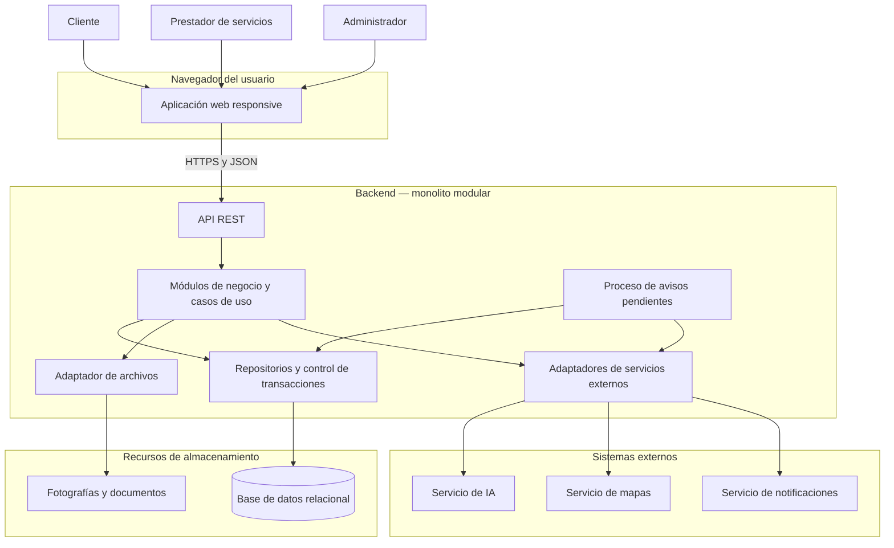

# Arquitectura inicial del sistema

## Diagrama de arquitectura

El diagrama muestra la comunicación general durante la ejecución.

El backend contiene la API, los módulos y los adaptadores. La base de datos, el almacenamiento de archivos y los proveedores externos se representan fuera de ese límite porque son recursos utilizados por la aplicación.

Los módulos de negocio se agrupan en una sola vista para facilitar la lectura; sus responsabilidades se detallan en el apartado de lógica de negocio.

Las flechas representan llamadas e intercambio de información, no las dependencias de importación del código.

El proceso de avisos pendientes forma parte de la solución del backend. Inicialmente no requiere un servicio de colas independiente y puede consultar las tareas guardadas en la misma base de datos.

La separación entre base de datos y archivos es lógica. Su ubicación física dependerá del despliegue seleccionado.

## Descripción

### 1. Descripción general

La plataforma se organizará en tres capas principales:

- **Presentación:** permite que los usuarios consulten información y realicen sus operaciones.
- **Lógica de negocio:** aplica las reglas de búsqueda, solicitudes, cotizaciones, contratación y seguimiento.
- **Datos:** conserva la información y los archivos necesarios para el funcionamiento del sistema.

La aplicación web se ejecutará en el navegador. El backend será una aplicación de servidor que incluirá la API REST, los módulos de negocio y las implementaciones para acceder al almacenamiento y a los servicios externos.

El backend se organizará como un monolito modular. Esto significa que sus módulos tendrán responsabilidades separadas, pero inicialmente se ejecutarán y desplegarán juntos.

Dentro de los módulos se aplicará Clean Architecture para separar las reglas del negocio de la interfaz, el almacenamiento y los proveedores externos.

### 2. Actores principales

| Actor | Participación |
|---|---|
| Cliente | Busca servicios, publica solicitudes, compara propuestas, contrata y revisa los trabajos. |
| Prestador de servicios | Publica servicios, responde solicitudes, cotiza y registra avances y entregas. |
| Administrador | Gestiona categorías, revisa usuarios y publicaciones y atiende incidencias. |

El prestador puede ser un trabajador de oficio, técnico, profesional o empresa de construcción civil.

### 3. Capa de presentación

#### Responsabilidad

Permitir la interacción con la plataforma desde celulares, tabletas, computadoras y laptops.

#### Elementos principales

| Elemento | Responsabilidad | Dónde se ejecuta |
|---|---|---|
| Aplicación web responsive | Mostrar formularios, resultados de búsqueda, perfiles, cotizaciones y seguimiento. Incluye las opciones del cliente, prestador y administrador según sus permisos. | Navegador del usuario. |
| API REST | Recibir peticiones, comprobar los datos de entrada y la identidad, invocar los casos de uso y devolver respuestas. | Backend. |

La aplicación web se comunicará con la API mediante HTTPS y mensajes JSON.

Las comprobaciones realizadas en la pantalla ayudarán al usuario, pero no sustituirán las validaciones y los controles de acceso del servidor.

La autorización de cada operación también comprobará si el usuario participa en la solicitud, contratación o documento que intenta utilizar.

### 4. Capa de lógica de negocio

#### Responsabilidad

Organizar las funciones y aplicar las reglas necesarias para pasar de una solicitud a una contratación y a su finalización.

#### Módulos principales

| Módulo | Responsabilidad |
|---|---|
| Usuarios y acceso | Gestionar cuentas, autenticación, perfiles de acceso y permisos. |
| Prestadores | Gestionar especialidades, experiencia, zonas de atención, disponibilidad declarada y verificación de información. |
| Catálogo y búsqueda | Organizar categorías y servicios, consultar perfiles y aplicar filtros. Utilizar la interpretación de IA como apoyo a la búsqueda. |
| Solicitudes y visitas | Gestionar solicitudes dirigidas o publicadas y coordinar visitas técnicas. |
| Cotizaciones | Registrar propuestas, aclaraciones, versiones, vigencia y comparación de condiciones. |
| Contrataciones y acuerdos | Confirmar contrataciones, conservar condiciones aceptadas, preparar documentos y gestionar cambios y cancelaciones. |
| Seguimiento y pagos registrados | Registrar avances, etapas, observaciones, conformidad y pagos realizados directamente al prestador. No procesa dinero. |
| Calificaciones | Gestionar valoraciones de contrataciones finalizadas y confirmadas. |
| Notificaciones | Registrar avisos internos y coordinar el envío de avisos externos. |
| Administración e incidencias | Gestionar revisiones, moderación, incidencias, reportes y auditoría administrativa. |

#### Organización interna

| Parte | Qué contiene |
|---|---|
| Dominio | Entidades y reglas del negocio, como las condiciones para contratar, aceptar cambios o finalizar un trabajo. |
| Aplicación | Casos de uso que coordinan operaciones, como publicar una solicitud, aceptar una propuesta o registrar un avance. |
| Contratos | Operaciones que el núcleo necesita para consultar datos, guardar información, manejar archivos o utilizar servicios externos. |

Los módulos se comunicarán mediante sus operaciones públicas. Un módulo no modificará directamente los registros administrados por otro.

Las operaciones que involucren varios módulos se coordinarán mediante casos de uso y los mecanismos de transacción correspondientes.

### 5. Datos y acceso al almacenamiento

#### Responsabilidad

Conservar la información para que las operaciones no se pierdan al cerrar el navegador o reiniciar el backend.

Se distinguirán los recursos donde se guarda la información del código que permite acceder a ellos.

#### Recursos de almacenamiento

| Recurso | Información que conserva |
|---|---|
| Base de datos relacional | Usuarios, perfiles, servicios, solicitudes, cotizaciones, contrataciones, acuerdos, avances, pagos registrados, calificaciones, avisos e incidencias. |
| Almacenamiento de archivos | Fotografías, documentos de verificación, documentos de contratación y evidencias de los trabajos. |

La base de datos conservará las referencias y los datos de identificación de los archivos, junto con la información necesaria para controlar su acceso.

El motor de base de datos y la ubicación del almacenamiento de archivos se elegirán durante la selección tecnológica.

#### Código de acceso dentro del backend

| Elemento | Responsabilidad |
|---|---|
| Repositorios | Implementar las consultas y el guardado de datos estructurados. |
| Adaptador de archivos | Implementar la carga, recuperación y gestión de fotografías y documentos. |
| Control de transacciones | Coordinar cambios relacionados para que se completen correctamente o se descarten si ocurre una falla. |

Estos elementos pertenecen a la infraestructura del backend. No son aplicaciones independientes ni reglas del dominio.

Los archivos privados se entregarán únicamente después de comprobar los permisos del usuario.

### 6. Sistemas externos

| Sistema externo | Uso | Alternativa ante una falla |
|---|---|---|
| Servicio de inteligencia artificial | Interpretar la necesidad descrita por el cliente y proponer criterios de búsqueda. | Continuar mediante categorías y filtros. |
| Servicio de notificaciones | Enviar avisos por los canales externos habilitados. | Conservar el aviso pendiente y reintentar su envío. |
| Servicio de mapas o ubicación | Apoyar la selección de referencias geográficas. | Permitir seleccionar manualmente la zona. |

Las conexiones con estos servicios se implementarán mediante adaptadores dentro del backend.

La IA ayudará a interpretar la necesidad, pero la búsqueda de prestadores se realizará sobre los registros de la plataforma.

Las llamadas y los enlaces de WhatsApp serán canales de contacto. No permitirán leer ni registrar automáticamente lo conversado fuera del sistema.

### 7. Flujo general de una contratación

1. El cliente busca un servicio o registra una solicitud desde la aplicación web.
2. La aplicación envía la petición a la API REST.
3. El backend valida los datos, comprueba los permisos y ejecuta el caso de uso.
4. La información se consulta o guarda mediante los contratos y sus implementaciones.
5. El prestador revisa la solicitud y envía una cotización.
6. El cliente compara las propuestas y elige una.
7. Si la oferta permite aceptación directa y conserva sus condiciones vigentes, se confirma la contratación. En caso contrario, se espera la confirmación del prestador.
8. El backend guarda de forma coordinada la contratación, el cambio de estado de la solicitud y el resultado de las propuestas restantes.
9. Se conserva el resumen del acuerdo y se registran los avisos pendientes.
10. La aplicación muestra el resultado y el proceso de notificaciones atiende los envíos externos.
11. El trabajo continúa con seguimiento breve o por etapas, según su complejidad.
12. El prestador comunica que terminó y el cliente confirma su conformidad o registra observaciones.

Una falla al enviar una notificación no debe deshacer ni presentar como fallida una contratación ya confirmada.

### 8. Reglas principales de la arquitectura

- La aplicación web no accede directamente a la base de datos.
- Las reglas y validaciones principales se ejecutan en el servidor.
- Las claves privadas de proveedores permanecen en el backend.
- El dominio no depende de frameworks, consultas SQL ni proveedores externos.
- Los repositorios y adaptadores implementan contratos definidos por el núcleo.
- Los módulos utilizan operaciones públicas para comunicarse.
- Las contrataciones y cambios de acuerdos se guardan con controles que evitan duplicados y actualizaciones incompletas.
- Los avisos externos se procesan después de confirmar la operación principal.
- El historial del trabajo y la auditoría administrativa tienen permisos de consulta distintos.
- Los pagos se realizan directamente al prestador; el sistema solo registra declaraciones y confirmaciones.

### 9. Relación con las decisiones arquitectónicas

| Decisiones | Aplicación en esta propuesta |
|---|---|
| ADR-001 y ADR-002 | Backend modular con separación interna mediante Clean Architecture. |
| ADR-003 y ADR-004 | Aplicación web responsive, API REST y pasos adecuados al tamaño del trabajo. |
| ADR-005 y ADR-006 | Base de datos relacional, operaciones consistentes y controles de acceso. |
| ADR-007 y ADR-008 | Adaptadores externos y separación entre la interpretación de IA y la búsqueda real. |
| ADR-009 y ADR-010 | Avisos pendientes y consultas con filtros, índices y paginación. |
| ADR-011 y ADR-012 | Gestión separada de archivos, versiones de acuerdos y auditoría administrativa. |
