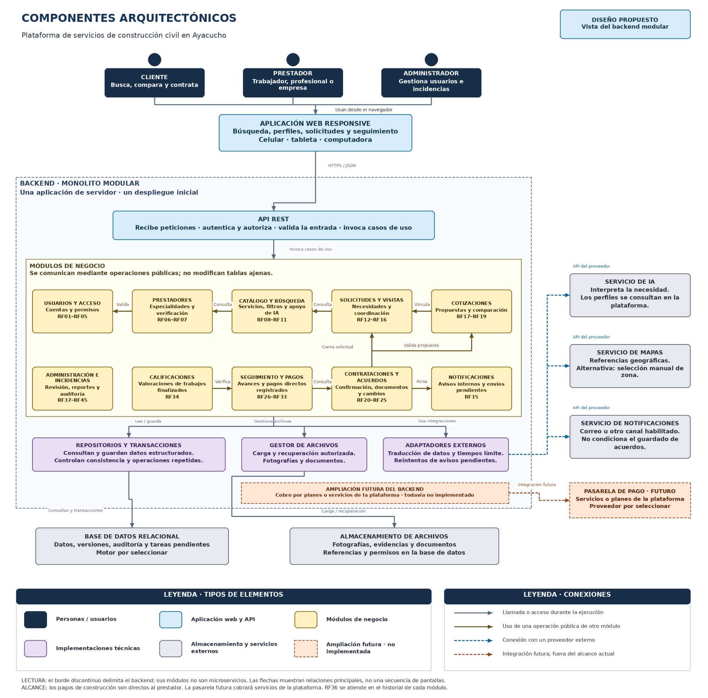

# Componentes arquitectónicos

[Archivo editable en Draw.io](../../img/fuentes-svg/componentes-arquitectonicos.drawio) · [Versión SVG](../../img/fuentes-svg/componentes-arquitectonicos.svg)

La plataforma incluye una aplicación web responsive y un backend con API REST, diez módulos de negocio, repositorios y adaptadores. La base de datos relacional y los archivos son recursos utilizados por el backend; no son módulos de negocio.

Los módulos se comunican mediante operaciones públicas. Las flechas de esta vista representan llamadas durante la ejecución. La pasarela de pagos se muestra como ampliación futura para cobrar planes o servicios de la plataforma; los trabajos se pagan directamente al prestador.
