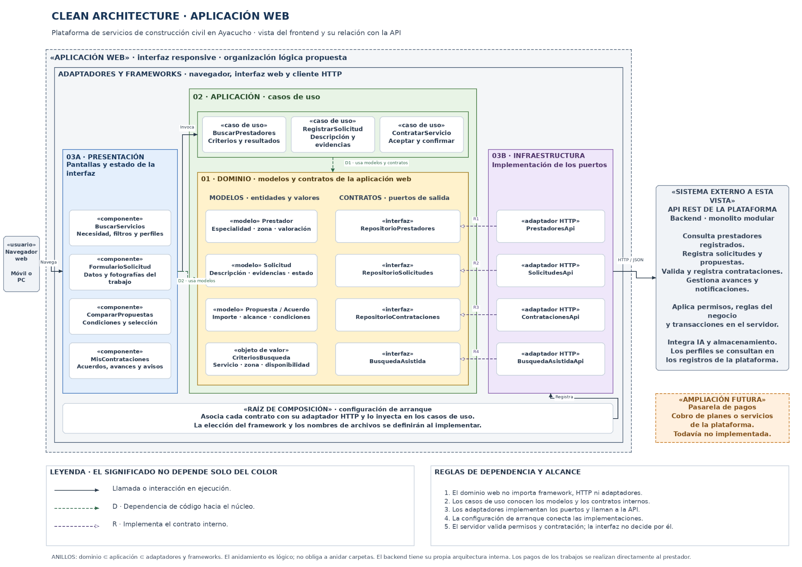

# Enfoque arquitectónico

Se utiliza **Clean Architecture** para separar las reglas y los contratos internos de los detalles de interfaz, persistencia e integración.

| Elemento | Descripción aplicada a la plataforma |
|---|---|
| Enfoque arquitectónico | Clean Architecture. |
| Objetivo | Mantener el dominio independiente de frameworks, clientes HTTP, bases de datos y proveedores externos. |
| Problema que resuelve | Evita que un cambio de interfaz o de proveedor obligue a reescribir las reglas de búsqueda y contratación. |
| Capas definidas | Presentación, Aplicación, Dominio e Infraestructura. La raíz de composición crea y conecta las implementaciones. |
| Aplicación en el proyecto | La interfaz web organiza pantallas, casos de uso, modelos y adaptadores HTTP. El backend mantiene sus propios casos de uso, reglas, contratos e implementaciones. |
| Beneficios | Facilita las pruebas, concentra las responsabilidades y permite sustituir detalles técnicos respetando los contratos. |

[Archivo editable en Draw.io](../../img/fuentes-svg/enfoque-clean-architecture.drawio) · [Versión SVG](../../img/fuentes-svg/enfoque-clean-architecture.svg)

La imagen sigue el alcance del ejemplo de la guía: describe la **aplicación web** y representa el backend como sistema externo a esa vista. Ambos forman parte de la plataforma. El servidor conserva la autoridad para validar permisos, registrar contrataciones y aplicar transacciones.

En los diagramas del módulo de backend Contrataciones y acuerdos, los puertos de salida se ubican en Aplicación. Esta decisión no se confunde con los contratos del frontend mostrados en la imagen. La dependencia del código apunta a contratos y reglas internas, aunque durante la ejecución un caso de uso invoque una implementación concreta.
