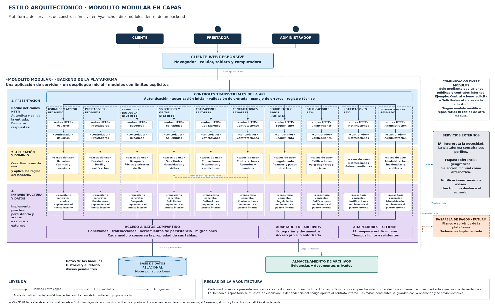

# Estilo arquitectónico

Se utiliza un **monolito modular organizado en capas**. El backend comienza como una aplicación de servidor y un despliegue, con diez módulos de responsabilidades separadas.

[Archivo editable en Draw.io](../../img/fuentes-svg/estilo-monolito-modular.drawio) · [Versión SVG](../../img/fuentes-svg/estilo-monolito-modular.svg)

| Capa | Responsabilidad |
|---|---|
| Presentación | Recibir peticiones HTTP, identificar al usuario, validar la entrada y convertir resultados a respuestas. |
| Aplicación y dominio | Coordinar casos de uso, comprobar permisos de la operación y aplicar las reglas del negocio. |
| Infraestructura y datos | Implementar los contratos de persistencia, transacciones, archivos y servicios externos. |

Cada módulo conserva la propiedad de sus datos y utiliza operaciones públicas de los otros módulos. Compartir una base de datos y herramientas de acceso no permite modificar libremente tablas ajenas.

Las flechas verticales muestran llamadas en ejecución. Los casos de uso dependen de interfaces internas y reciben sus implementaciones desde la composición; por ello el estilo en capas es compatible con Clean Architecture.

Los avisos se registran con la operación principal y se envían después del commit. La pasarela de pagos se mantiene como ampliación futura y no participa en el pago directo del trabajo al prestador.
