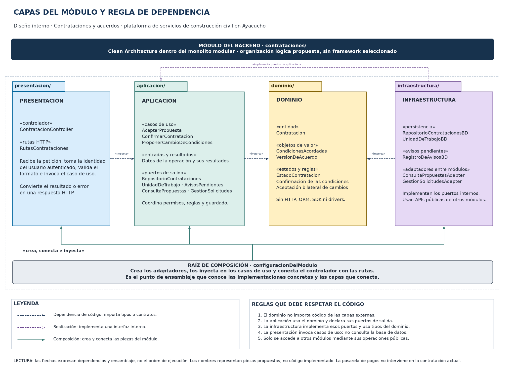

# Diseño interno de módulos

> **Proyecto:** Plataforma web para la búsqueda y contratación de servicios de construcción civil en Ayacucho.  
> **Módulo de referencia:** Contrataciones y acuerdos.  
> **Enfoque interno:** Clean Architecture dentro de un monolito modular organizado en capas.  
> **Estado:** diseño propuesto; el framework, el motor y los archivos definitivos se elegirán al implementar.

## 1. Propósito

Este documento define cómo se organiza el código dentro del módulo de referencia. Busca que todos los módulos sigan responsabilidades claras, que las reglas del negocio permanezcan separadas de la tecnología y que el equipo identifique dónde corresponde cada pieza y de qué puede depender.

Se desarrolla AceptarPropuesta como caso de uso principal. El módulo también contempla la confirmación del prestador y los cambios de condiciones acordados entre las partes.

## 2. Estructura de carpetas

La siguiente es la **estructura lógica propuesta para el backend**, no una afirmación de que estos archivos ya estén implementados. Las extensiones se definirán al elegir el lenguaje. La carpeta `tecnologia/` del repositorio contiene, por ahora, una estructura reservada para el ejemplo tecnológico.

| Ruta dentro de `src/modules/contrataciones/` | Pieza de referencia | Responsabilidad | Depende de |
|---|---|---|---|
| `dominio/contratacion` | Contratacion | Mantener participantes, estado, versiones y reglas de aceptación. | Tipos del dominio. |
| `dominio/condiciones-acordadas` | CondicionesAcordadas | Representar alcance, importe, moneda, plazo, materiales y exclusiones. | Tipos del dominio. |
| `dominio/version-de-acuerdo` | VersionDeAcuerdo | Conservar una versión inmutable aceptada. | CondicionesAcordadas. |
| `dominio/cambio-condiciones` | CambioCondiciones | Registrar un cambio y las aceptaciones de sus participantes. | Tipos del dominio. |
| `dominio/estado-contratacion` | EstadoContratacion | Definir los estados válidos del acuerdo. | Ninguna capa externa. |
| `dominio/estado-cambio` | EstadoCambio | Definir PENDIENTE, ACEPTADO y RECHAZADO. | Ninguna capa externa. |
| `aplicacion/aceptar-propuesta` | AceptarPropuesta | Coordinar la aceptación y su guardado. | Dominio y puertos de aplicación. |
| `aplicacion/confirmar-contratacion` | ConfirmarContratacion | Registrar la confirmación pendiente del prestador. | Dominio y puertos de aplicación. |
| `aplicacion/proponer-cambio` | ProponerCambioDeCondiciones | Coordinar una propuesta de cambio de condiciones. | Dominio y puertos de aplicación. |
| `aplicacion/entradas-y-resultados/` | Comandos y resultados | Transportar los datos de cada operación sin depender de HTTP. | Tipos internos. |
| `aplicacion/puertos/repositorio-contrataciones` | RepositorioContrataciones | Declarar la búsqueda y el guardado de contrataciones. | Contratacion. |
| `aplicacion/puertos/unidad-de-trabajo` | UnidadDeTrabajo | Coordinar la operación transaccional. | Contratos internos. |
| `aplicacion/puertos/avisos-pendientes` | AvisosPendientes | Declarar el registro del aviso que se enviará después. | AvisoContratacion. |
| `aplicacion/puertos/consulta-propuestas` | ConsultaPropuestas | Declarar la consulta de una propuesta vigente. | Tipos internos de consulta. |
| `aplicacion/puertos/gestion-solicitudes` | GestionSolicitudes | Declarar la validación y el vínculo de la solicitud. | Tipos internos. |
| `infraestructura/repositorio-contrataciones-bd` | RepositorioContratacionesBD | Implementar la persistencia y sus controles de concurrencia. | Puertos, dominio y herramientas de datos. |
| `infraestructura/unidad-de-trabajo-bd` | UnidadDeTrabajoBD | Confirmar o revertir los cambios coordinados. | Puertos y contexto transaccional. |
| `infraestructura/registro-de-avisos-bd` | RegistroDeAvisosBD | Guardar avisos pendientes en la misma transacción. | AvisosPendientes y contexto transaccional. |
| `infraestructura/consulta-propuestas-adapter` | ConsultaPropuestasAdapter | Utilizar la API pública de Cotizaciones. | Puerto y API pública del módulo. |
| `infraestructura/gestion-solicitudes-adapter` | GestionSolicitudesAdapter | Utilizar la API pública de Solicitudes. | Puerto y API pública del módulo. |
| `presentacion/contratacion-controller` | ContratacionController | Traducir HTTP a llamadas del caso de uso y devolver respuestas. | Aplicación y herramientas HTTP. |
| `presentacion/contrataciones-routes` | RutasContrataciones | Registrar las rutas del módulo. | Presentación. |
| `configuracion-del-modulo` | Raíz de composición | Crear e inyectar las implementaciones. | Las piezas que necesita conectar. |
| `api-publica` | Operaciones públicas del módulo | Exponer lo que otros módulos pueden utilizar. | Aplicación; sin exponer repositorios privados. |

## 3. Capas del módulo y regla de dependencia



[Archivo editable en Draw.io](../../../img/fuentes-svg/capas-modulo-contrataciones.drawio) · [Versión SVG](../../../img/fuentes-svg/capas-modulo-contrataciones.svg)

**Regla de dependencia:** el dominio no importa código de las capas externas. La aplicación utiliza el dominio y sus propios contratos; la infraestructura implementa esos contratos. La presentación invoca los casos de uso.

| Capa | Contiene | Responsabilidad | Puede depender de | No puede depender de |
|---|---|---|---|---|
| Dominio | Entidades, valores y estados. | Aplicar las reglas del acuerdo. | Tipos propios del negocio. | Aplicación, presentación, infraestructura, HTTP, ORM y SDK. |
| Aplicación | Casos de uso, entradas, resultados y puertos. | Coordinar las operaciones y sus permisos. | Dominio y contratos internos. | Controladores, repositorios concretos y drivers. |
| Infraestructura | Repositorios y adaptadores concretos. | Implementar persistencia e integraciones. | Puertos de aplicación, dominio y herramientas externas. | Presentación e implementaciones privadas de otros módulos. |
| Presentación | Controladores y rutas. | Traducir peticiones y respuestas. | Aplicación y herramientas HTTP. | Acceso directo a datos e implementaciones de repositorio. |
| Composición | Configuración del módulo. | Elegir y conectar las implementaciones. | Las capas que ensambla. | No contiene reglas del negocio. |

Los puertos de salida del backend se ubican en Aplicación. ConsultaPropuestasAdapter y GestionSolicitudesAdapter llaman a operaciones públicas de los módulos propietarios, sin modificar directamente sus tablas.

Para comprobar la regla, se revisan los imports: Dominio no debe conocer el framework ni el motor, y Aplicación no debe importar las implementaciones de Infraestructura.

## 4. Diagrama de clases


[Archivo editable en Draw.io](../../../img/fuentes-svg/clases-contrataciones.drawio) · [Versión SVG](../../../img/fuentes-svg/clases-contrataciones.svg)

El diagrama usa AceptarPropuesta como referencia. Los cinco puertos se muestran en una zona inferior de Aplicación para alinear cada contrato con su adaptador. Contratacion conserva las condiciones iniciales, el historial de versiones y un cambio pendiente como máximo.

Una propuesta firme, vigente y con disponibilidad confirmada previamente puede generar una contratación CONFIRMADA. Si falta esa confirmación, queda EN_CONFIRMACION. Al confirmar se genera la primera versión aceptada; los cambios posteriores solo crean una nueva versión cuando ambas partes los aceptan.

### 4.1. Notación UML utilizada

| Símbolo | Significado | Ejemplo en el diagrama |
|---|---|---|
| Línea continua con punta abierta | Asociación: el objeto conserva una referencia. | AceptarPropuesta → RepositorioContrataciones. |
| Línea discontinua con punta abierta | Dependencia: utiliza un tipo o crea una instancia. | ContratacionController → AceptarPropuestaCommand. |
| Línea discontinua con triángulo vacío | Realización: implementa una interfaz. | RepositorioContratacionesBD → RepositorioContrataciones. |
| Rombo relleno junto al todo | Composición: las partes pertenecen al agregado. | Contratacion → VersionDeAcuerdo. |
| «interface» | Contrato sin implementación concreta. | AvisosPendientes. |
| `-` / `+` | Miembro privado / público. | `- estado` / `+ confirmar()`. |
| `1`, `0..1`, `0..*` | Una instancia, opcional, o cero y muchas partes. | Historial de versiones `0..*` antes de la confirmación. |
| `{static}` | Método de creación llamado sobre la clase. | `crearConfirmada(datos)`. |

Los valores monetarios se representan en unidades menores enteras. Las condiciones y versiones aceptadas son inmutables. Los participantes y sus permisos se validan en el servidor; el navegador no determina los importes ni los estados definitivos.

## 5. Flujo de ejecución: aceptar una propuesta


[Archivo editable en Draw.io](../../../img/fuentes-svg/flujo-aceptar-propuesta.drawio) · [Versión SVG](../../../img/fuentes-svg/flujo-aceptar-propuesta.svg)

| Paso | Origen → destino | Acción | Capa |
|---|---|---|---|
| 1 | ClienteWeb → ContratacionController | Solicitar la aceptación con propuestaId, versión y clave idempotente. La identidad procede de la sesión. | Presentación. |
| 2 | ContratacionController → AceptarPropuesta | Invocar ejecutar con la entrada validada. | Presentación → Aplicación. |
| 3–6 | AceptarPropuesta → UnidadDeTrabajo → BD | Abrir la transacción, reservar la clave y ejecutar la operación en el contexto compartido. | Aplicación → Infraestructura. |
| 7 | AceptarPropuesta → ConsultaPropuestas | Obtener la propuesta vigente y sus condiciones registradas. | Aplicación → puerto. |
| 8 | AceptarPropuesta → GestionSolicitudes | Validar al cliente y la disponibilidad de la solicitud. | Aplicación → puerto. |
| 9 | AceptarPropuesta → RepositorioContrataciones | Comprobar que no existe otra contratación activa para la solicitud. | Aplicación → puerto. |
| 10a–10b | AceptarPropuesta → Contratacion | Crear CONFIRMADA o EN_CONFIRMACION, según la propuesta y su confirmación previa. | Aplicación → Dominio. |
| 11 | AceptarPropuesta → RepositorioContrataciones | Guardar con controles de versión y unicidad. | Aplicación → Infraestructura. |
| 12 | AceptarPropuesta → GestionSolicitudes | Registrar el vínculo con la contratación a través del módulo propietario. | Aplicación → puerto. |
| 13 | AceptarPropuesta → AvisosPendientes | Guardar el aviso en la misma transacción, sin enviarlo aún. | Aplicación → Infraestructura. |
| 14–16 | Operación → UnidadDeTrabajo → BD | Guardar el resultado idempotente y confirmar todos los cambios. | Aplicación → Infraestructura. |
| 17 | ContratacionController → ClienteWeb | Responder 201 con el identificador y el estado, después del commit. | Presentación. |
| Alternativa | Error de validación o de persistencia | Interrumpir la operación y revertir los cambios no confirmados. | Aplicación → Infraestructura → Presentación. |

**Condiciones del flujo:**

- La primera validación fallida interrumpe las llamadas restantes. Los bloques break agrupan el manejo de errores de cada fase.
- Una sola contratación activa por solicitud se protege con validación y una restricción de persistencia; la consulta previa no evita por sí sola una carrera concurrente.
- Una clave ya confirmada devuelve el resultado anterior. Reutilizarla con datos distintos genera un conflicto.
- El aviso se envía después del commit; una falla del proveedor no deshace la contratación.
- 201 significa que se creó el registro. Si está EN_CONFIRMACION, el prestador responde mediante ConfirmarContratacion en otra petición.
- Si una desconexión deja incierto el resultado del commit, no se asume un rollback: se resuelve el reintento mediante la misma clave.

Los errores se traducen a respuestas controladas: 401 o 400 antes del caso de uso; 403 sin permiso; 404 si no existe la propuesta; 409 por versión, vigencia o contratación activa; 422 por reglas de validación; y 500 por un fallo técnico inesperado.

## 6. Código de referencia

Los fragmentos siguientes son **pseudocódigo de diseño**, no archivos ejecutables ni una selección tecnológica. Conservan las responsabilidades y los nombres de los diagramas. Las consultas, errores, controles de acceso y tipos concretos se implementarán con la tecnología elegida.

### 6.1. Dominio · entidad y valores

```text
clase Contratacion
    privado estado
    privado condicionesIniciales
    privado versiones
    privado cambioPendiente

    estático crearPendiente(datos)
        validar participantes y condiciones de datos
        crear contratación en EN_CONFIRMACION
        conservar condicionesIniciales
        iniciar historial sin versiones aceptadas
        devolver contratación

    estático crearConfirmada(datos)
        exigir confirmación previa válida en los datos verificados
        crear contratación en CONFIRMADA
        crear primera VersionDeAcuerdo con las condiciones aceptadas
        devolver contratación

    aceptarCambio(actorId, cambioId)
        exigir que actorId sea participante de la contratación
        exigir que cambioId sea el cambio pendiente
        registrar aceptación de esa misma propuesta de cambio
        si ambos participantes aceptaron
            añadir nueva VersionDeAcuerdo
            conservar las versiones anteriores
            dejar de tener un cambio pendiente
```

### 6.2. Aplicación · contratos y caso de uso

```text
interfaz RepositorioContrataciones
    buscarPorId(id)
    buscarActivaPorSolicitud(solicitudId)
    guardar(contratacion, versionEsperada)

interfaz UnidadDeTrabajo
    ejecutar(operacion)

interfaz AvisosPendientes
    registrar(aviso)

interfaz ConsultaPropuestas
    obtenerVigente(propuestaId, versionPropuesta)

interfaz GestionSolicitudes
    validarClienteYDisponibilidad(solicitudId, actorId)
    registrarContratacion(solicitudId, contratacionId)

clase AceptarPropuesta
    recibir por constructor los cinco puertos anteriores

    ejecutar(cmd)
        preparar contexto de idempotencia con actor, operación,
        clave y huella de la entrada

        devolver unidadDeTrabajo.ejecutar(operación)
            propuesta = propuestas.obtenerVigente(
                cmd.propuestaId, cmd.versionPropuesta)
            solicitudes.validarClienteYDisponibilidad(
                propuesta.solicitudId, cmd.actorId)

            si contratos.buscarActivaPorSolicitud(propuesta.solicitudId) existe
                rechazar con conflicto

            datos = tomar participantes y condiciones de la propuesta registrada
            si propuesta es firme y tiene confirmación previa vigente
                contratacion = Contratacion.crearConfirmada(datos)
            en otro caso
                contratacion = Contratacion.crearPendiente(datos)

            contratos.guardar(contratacion, marcaDeEntidadNueva)
            solicitudes.registrarContratacion(
                propuesta.solicitudId, contratacion.id)
            avisos.registrar(aviso de la aceptación y su estado)
            devolver ResultadoAceptacion(contratacion.id, contratacion.estado)
```

UnidadDeTrabajo reserva la clave antes de ejecutar la operación, conserva su resultado y confirma la transacción. Si existe un resultado previo compatible, lo devuelve sin crear otra contratación. Repositorio, avisos y las operaciones públicas que actualizan solicitudes participan en el mismo contexto transaccional. La composición configura ese contexto; no se comparte una transacción mutable entre peticiones diferentes.

### 6.3. Infraestructura · repositorio y adaptadores

```text
clase RepositorioContratacionesBD implementa RepositorioContrataciones
    recibir contextoTransaccional

    guardar(contratacion, versionEsperada)
        traducir la entidad a datos de persistencia
        insertar o actualizar con el control de versión correspondiente
        respetar la restricción de contratación activa por solicitud
        convertir conflictos conocidos a errores internos definidos
        no confirmar una transacción por cuenta propia

clase RegistroDeAvisosBD implementa AvisosPendientes
    recibir el mismo contextoTransaccional

    registrar(aviso)
        guardar el aviso pendiente en ese contexto
        no llamar al proveedor de notificaciones dentro de la transacción
```

ConsultaPropuestasAdapter y GestionSolicitudesAdapter traducen sus operaciones a las APIs públicas de los módulos propietarios. El proceso de avisos pendientes utiliza el proveedor externo después del commit y debe controlar reintentos y posibles duplicados de entrega.

### 6.4. Presentación · controlador

```text
clase ContratacionController
    recibir aceptarPropuesta

    aceptarPeticion(http)
        exigir una sesión autenticada
        validar el formato de propuestaId, versionPropuesta y claveIdempotencia
        cmd.actorId = identidad obtenida de la sesión
        completar cmd con los campos de entrada permitidos
        resultado = aceptarPropuesta.ejecutar(cmd)
        devolver 201 con resultado.contratacionId y resultado.estado

        si ocurre un error
            traducirlo a la respuesta HTTP correspondiente
            no exponer detalles internos ni credenciales
```

### 6.5. Raíz de composición

```text
configurarModuloContrataciones()
    definir el contexto transaccional por operación
    crear RepositorioContratacionesBD
    crear UnidadDeTrabajoBD
    crear RegistroDeAvisosBD
    crear ConsultaPropuestasAdapter con la API pública de Cotizaciones
    crear GestionSolicitudesAdapter con la API pública de Solicitudes
    inyectar las implementaciones en AceptarPropuesta
    conectar ContratacionController con las rutas del módulo
```

El guardado de las condiciones, la vinculación de la solicitud y el aviso deben probarse como una sola operación. La pasarela de pagos no interviene en este caso de uso: los trabajos se pagan directamente al prestador; el cobro de servicios de la plataforma se implementará después.
