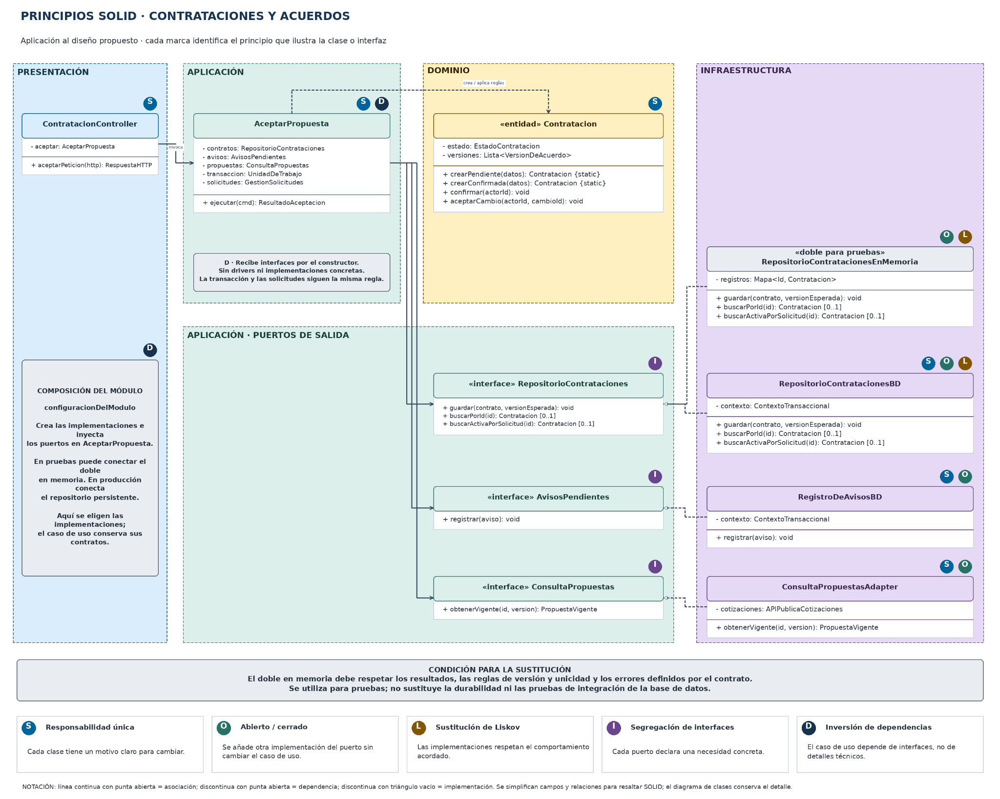

# Principios de diseño (SOLID)

## Objetivo

Documentar cómo se aplicarán los principios SOLID para separar responsabilidades, mantener contratos claros y evitar que las reglas de contratación dependan de la tecnología.

## Contexto

- **Estilo:** monolito modular organizado en capas.
- **Enfoque interno:** Clean Architecture.
- **Módulo de referencia:** Contrataciones y acuerdos.
- **Caso de uso de referencia:** AceptarPropuesta.
- **Estado:** diseño propuesto, pendiente de implementación y comprobación.

## SOLID en el módulo Contrataciones y acuerdos

[Archivo editable en Draw.io](../../../img/fuentes-svg/solid-modulo-contrataciones.drawio) · [Versión SVG](../../../img/fuentes-svg/solid-modulo-contrataciones.svg)

| Principio | Dónde se aplica (capa) | Cómo se cumple en el diseño de la plataforma | Clases o contratos |
|---|---|---|---|
| S · Responsabilidad única | Todas las capas. | El controlador traduce HTTP; el caso de uso coordina la aceptación; la entidad aplica las reglas; el repositorio resuelve persistencia. Cada pieza tiene un motivo de cambio propio. | ContratacionController, AceptarPropuesta, Contratacion, RepositorioContratacionesBD. |
| O · Abierto/cerrado | Contratos e infraestructura. | Se añade otra implementación compatible y se conecta desde composición sin reescribir la lógica de aceptación. Una nueva función o un cambio del contrato sí puede exigir modificaciones. | RepositorioContrataciones y sus implementaciones; adaptadores de integración. |
| L · Sustitución de Liskov | Implementaciones de los puertos. | Las implementaciones conservan los resultados, errores e invariantes del contrato. El doble en memoria respeta las reglas de versión y unicidad necesarias para el escenario de prueba. | RepositorioContratacionesBD, RepositorioContratacionesEnMemoria. |
| I · Segregación de interfaces | Aplicación. | Cada contrato agrupa una necesidad concreta: persistencia, consulta de propuestas o registro de avisos. Se evita una interfaz general con operaciones ajenas. | RepositorioContrataciones, ConsultaPropuestas, AvisosPendientes. |
| D · Inversión de dependencias | Aplicación y composición. | El caso de uso recibe interfaces y no construye repositorios ni importa drivers. La composición crea e inyecta las implementaciones. | AceptarPropuesta, configuracionDelModulo. |

Las marcas S, O, L, I y D identifican ejemplos de aplicación del principio, no resultados de pruebas ya ejecutadas. Las implementaciones deben superar pruebas de contrato sobre búsqueda, ausencia, guardado, conflicto de versión y duplicados. Coincidir en las firmas no basta para demostrar Liskov.

El repositorio en memoria es un doble para pruebas; no sustituye la durabilidad, el aislamiento ni las pruebas de integración del motor de datos.

## Qué pasaría sin SOLID en la plataforma

| Situación real | Sin SOLID | Con SOLID |
|---|---|---|
| Cambia una regla para aceptar condiciones. | La regla puede repetirse en pantallas, controladores y servicios. | Se mantiene en el dominio y el caso de uso coordina su aplicación. |
| Se sustituye un proveedor o mecanismo de persistencia. | El caso de uso conoce llamadas y formatos del proveedor. | Se implementa el contrato compatible y se ajusta la composición. |
| Se prueba la aceptación de una propuesta. | Las pruebas dependen de servicios reales para cada escenario. | Se utilizan dobles controlados y se complementan con pruebas de integración. |
| Se añade otra función al módulo. | Una clase general acumula tareas y dependencias. | La nueva responsabilidad se ubica en la pieza correspondiente sin mezclarla con las existentes. |

## Relación con Clean Architecture y los patrones

| Principio | Decisión que lo favorece en el proyecto |
|---|---|
| Responsabilidad única | Separar controlador, caso de uso, entidad y repositorio. |
| Abierto/cerrado y Liskov | Utilizar contratos e implementaciones mediante Repository y Adapter, comprobando su compatibilidad. |
| Segregación de interfaces | Declarar puertos pequeños según las necesidades de la aplicación. |
| Inversión de dependencias | Dirigir los imports hacia contratos y dominio, conectando las implementaciones desde la composición. |

SOLID no exige crear clases sin una necesidad concreta. La pasarela para planes o servicios de la plataforma sigue pendiente y no se incorpora al caso de uso AceptarPropuesta.
