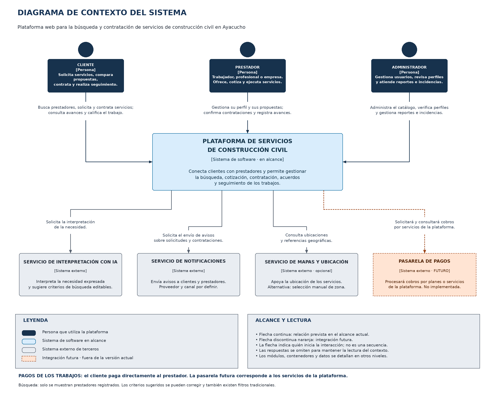

# Nivel 1 · Diagrama de contexto del sistema

> **Proyecto:** Plataforma web para la búsqueda y contratación de servicios de construcción civil en Ayacucho.  
> **Modelo:** C4 · Nivel 1.  
> **Alcance:** personas y sistemas que se relacionan con la plataforma.

## 1. Objetivo

Mostrar quién utiliza la plataforma y con qué sistemas externos se comunica. En este nivel la plataforma aparece como un solo sistema, sin mostrar sus aplicaciones internas, módulos ni almacenes de datos.

| Aspecto | Descripción |
|---|---|
| Pregunta que responde | ¿Quién usa la plataforma y con qué otros sistemas se relaciona? |
| Audiencia | Usuarios interesados, docente y equipo del proyecto. |
| Sistema en alcance | Plataforma de búsqueda y contratación de servicios de construcción civil en Ayacucho. |
| Siguiente nivel | Contenedores: aplicación web, API y almacenes de datos. |

## 2. Diagrama

[Editar en Draw.io](../../img/fuentes-svg/nivel1-contexto.drawio) · [Versión SVG](../../img/fuentes-svg/nivel1-contexto.svg)

El sistema cubre servicios de construcción civil desde estudios y diseño hasta ejecución, instalaciones, acabados, reparación, mantenimiento y supervisión. La cobertura inicial corresponde a las zonas habilitadas de Ayacucho.

## 3. Personas

| Persona | Participación |
|---|---|
| Cliente | Busca prestadores, consulta perfiles, solicita servicios, compara propuestas, contrata, revisa avances y califica trabajos finalizados. |
| Prestador de servicios | Presenta sus especialidades y experiencia, responde solicitudes, envía propuestas, confirma condiciones y disponibilidad y registra avances y finalización. Puede ser trabajador de oficio, técnico, profesional o empresa. |
| Administrador | Gestiona categorías y usuarios, revisa perfiles y publicaciones y atiende reportes e incidencias. |

Una cuenta puede reunir los perfiles de cliente y prestador. Los permisos de una operación también dependen de la participación del usuario en la solicitud o contratación correspondiente.

## 4. Sistemas

| Sistema | Responsabilidad | Situación en el alcance |
|---|---|---|
| Plataforma de construcción civil | Conectar clientes y prestadores y conservar solicitudes, propuestas, acuerdos y seguimiento. | Sistema que se diseña y desarrollará. |
| Servicio de interpretación con IA | Interpretar una necesidad descrita en lenguaje natural y sugerir criterios de búsqueda editables. | Integración prevista mediante un adaptador; proveedor por seleccionar. |
| Servicio de notificaciones | Entregar avisos por los canales externos habilitados. | Integración prevista; canal y proveedor por seleccionar. |
| Servicio de mapas y ubicación | Apoyar la selección de referencias geográficas. | Opcional; existe selección manual de zona. |
| Pasarela de pagos | Procesar cobros por planes o servicios propios de la plataforma. | Ampliación futura, fuera de la implementación inicial. |

Teléfono y WhatsApp son medios de contacto permitidos. No se representan como integraciones que lean conversaciones o registren automáticamente acuerdos externos.

## 5. Relaciones

| Origen | Destino | Propósito |
|---|---|---|
| Cliente | Plataforma | Buscar, solicitar y contratar servicios y consultar el seguimiento. |
| Prestador | Plataforma | Gestionar su perfil, cotizar, confirmar contrataciones y registrar avances. |
| Administrador | Plataforma | Gestionar información y atender reportes e incidencias. |
| Plataforma | Interpretación con IA | Obtener criterios sugeridos a partir de la necesidad del cliente. |
| Plataforma | Notificaciones | Solicitar la entrega de avisos de las operaciones. |
| Plataforma | Mapas | Consultar ubicaciones y referencias cuando se habilite esta opción. |
| Plataforma | Pasarela de pagos | Solicitar y consultar cobros propios cuando se implemente la ampliación. |

Las flechas indican quién inicia la interacción y su finalidad. Las respuestas se omiten; el diagrama no representa una secuencia temporal ni las dependencias del código. El borde y la flecha discontinuos de la pasarela identifican la integración futura.

## 6. Decisiones, supuestos y pendientes

| Tema | Decisión o condición |
|---|---|
| Dispositivos | Se accede mediante navegador desde celular, tableta y computadora. |
| Búsqueda asistida | La interpretación produce criterios corregibles. Los resultados se obtienen de prestadores registrados; no se generan perfiles inexistentes. |
| Continuidad | Se mantienen categorías y filtros tradicionales si la interpretación externa no está disponible. |
| Ubicación | La selección manual de zona permite continuar sin mapas. |
| Acuerdos | Una conversación fuera de la plataforma no actualiza por sí sola las condiciones registradas. Las partes deben confirmar en el sistema lo que corresponda. |
| Pago del trabajo | El cliente paga directamente al prestador. El sistema registra declaraciones y confirmaciones; no procesa ni verifica el movimiento bancario. |
| Ingresos de la plataforma | Los cobros por planes o servicios propios quedan previstos para una ampliación. No se establece una comisión por trabajo. |
| Selección tecnológica | Los proveedores concretos se elegirán durante la implementación. |

Este nivel desarrolla el contexto definido en el [análisis del sistema](../01-analisis-de-sistema/00-contexto-y-problematica.md) y sus [actores](../01-analisis-de-sistema/01-actores.md).

---

[Índice del proyecto](../../README.md) · [Siguiente nivel](02-nivel2-contenedores.md)
