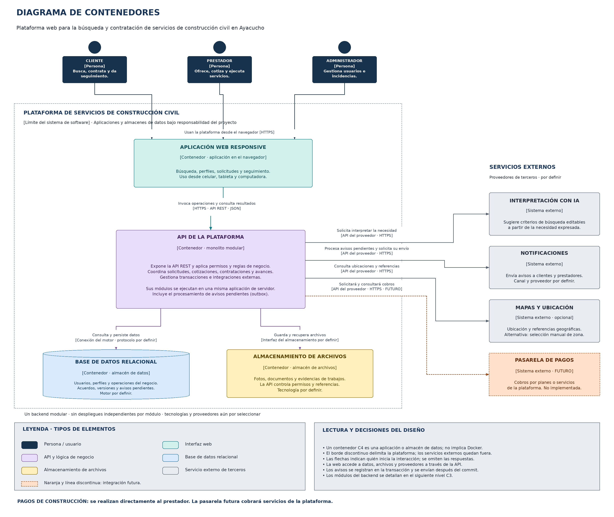

# Nivel 2 · Diagrama de contenedores

> **Proyecto:** Plataforma web para la búsqueda y contratación de servicios de construcción civil en Ayacucho.  
> **Modelo:** C4 · Nivel 2.  
> **Alcance:** aplicaciones y almacenes de datos que forman la plataforma.

## 1. Objetivo

Abrir el sistema mostrado en el nivel 1 para identificar sus contenedores, sus responsabilidades y la comunicación entre ellos y con los proveedores externos.

| Aspecto | Descripción |
|---|---|
| Pregunta que responde | ¿Qué aplicaciones y almacenes forman el sistema y cómo se comunican? |
| Audiencia | Equipo de arquitectura y desarrollo. |
| Contenedor C4 | Una aplicación o almacén de datos. El término no exige usar Docker. |
| Contenedor que se detalla después | API de la plataforma: monolito modular. |

## 2. Diagrama

[Editar en Draw.io](../../img/fuentes-svg/nivel2-contenedores.drawio) · [Versión SVG](../../img/fuentes-svg/nivel2-contenedores.svg)

El borde discontinuo delimita el sistema bajo responsabilidad del proyecto. Los proveedores externos se ubican fuera. Este límite es lógico: no fija servidores, redes o un proveedor de alojamiento.

## 3. Contenedores

| Contenedor | Responsabilidad | Ejecución o almacenamiento | Tecnología |
|---|---|---|---|
| Aplicación web responsive | Mostrar búsqueda, perfiles, solicitudes, propuestas y seguimiento según los permisos del usuario. | Navegador del cliente, prestador o administrador. | Framework por definir. |
| API de la plataforma | Validar identidad y permisos, ejecutar casos de uso y reglas de negocio y coordinar datos e integraciones. | Una aplicación de servidor organizada como monolito modular. | Lenguaje y framework por definir. |
| Base de datos relacional | Conservar datos del negocio, versiones, controles de idempotencia y avisos pendientes. | Almacén persistente de datos estructurados. | Motor por definir. |
| Almacenamiento de archivos | Conservar fotografías, documentos y evidencias. La base de datos mantiene sus referencias. | Almacén de archivos controlado por la API. | Solución local o servicio por definir. |

La API contiene los módulos de Usuarios, Prestadores, Catálogo y búsqueda, Solicitudes y visitas, Cotizaciones, Contrataciones y acuerdos, Seguimiento y pagos registrados, Calificaciones, Notificaciones y Administración e incidencias. Son componentes internos del mismo contenedor, no aplicaciones independientes.

La base de datos y los archivos son recursos distintos por responsabilidad. Pueden utilizar infraestructura administrada sin cambiar su lugar lógico en el sistema.

## 4. Relaciones

| Origen | Destino | Acción | Comunicación prevista |
|---|---|---|---|
| Personas | Aplicación web | Utilizar la plataforma desde el navegador. | HTTPS. |
| Aplicación web | API | Invocar operaciones y consultar resultados. | API REST sobre HTTPS con JSON. |
| API | Base de datos | Consultar y persistir información mediante repositorios y transacciones. | Conexión propia del motor; protocolo por definir. |
| API | Almacenamiento de archivos | Guardar y recuperar documentos y evidencias autorizados. | Interfaz de la solución seleccionada. |
| API | Servicio de interpretación con IA | Solicitar criterios de búsqueda sugeridos. | API del proveedor sobre HTTPS; formato por definir. |
| API | Servicio de notificaciones | Enviar avisos pendientes después de confirmar la operación principal. | API del proveedor sobre HTTPS; canal por definir. |
| API | Servicio de mapas | Consultar ubicaciones y referencias. | API del proveedor sobre HTTPS; uso opcional. |
| API, mediante la ampliación futura | Pasarela de pagos | Solicitar y consultar cobros por planes o servicios propios. | API del proveedor sobre HTTPS, pendiente de implementar. |

Las respuestas se omiten para facilitar la lectura. Las conexiones describen ejecución, no importaciones del código ni una secuencia de pasos.

## 5. Decisiones reflejadas

| Decisión | Cómo aparece en el modelo |
|---|---|
| Monolito modular | Un solo contenedor API para todos los módulos del backend. |
| Clean Architecture | Los casos de uso y las reglas quedan separados de los adaptadores internos. Su detalle aparece en diseño y en los siguientes niveles. |
| Web responsive | Una aplicación web para celulares, tabletas y computadoras. |
| Persistencia relacional | Datos relacionados, transacciones, control de versión y unicidad. |
| Archivos separados de datos estructurados | Almacén propio para fotos y documentos; referencias y permisos en la base de datos. |
| Outbox transaccional | Los cambios y avisos pendientes se registran juntos; el envío externo se realiza después del commit. |
| Proveedores reemplazables | Integraciones mediante adaptadores dentro de la API. |
| Crecimiento gradual | La pasarela se identifica como futura; no se agrega caché ni microservicios sin una necesidad justificada. |

El procesamiento de avisos pendientes forma parte del backend inicial. Puede consultar la misma base de datos y no requiere una cola ni un contenedor de ejecución independiente. Se prevén reintentos y deduplicación.

## 6. Seguridad

| Área | Regla del diseño |
|---|---|
| Entrada de operaciones | La API valida identidad, permisos y datos, aunque la interfaz ya haya realizado comprobaciones. |
| Acceso a datos | La aplicación web no se conecta directamente a la base de datos ni modifica estados definitivos. |
| Archivos privados | La API comprueba permisos antes de entregar o permitir recuperar el archivo. El mecanismo concreto se elegirá con el almacenamiento. |
| Credenciales de proveedores | Se conservan en el servidor, fuera del navegador y del repositorio. |
| Operaciones concurrentes | Versión esperada, transacciones e idempotencia evitan sobrescrituras y duplicados. |
| Cambios de acuerdo | Se conservan las versiones aceptadas y se valida la participación de ambas partes. |
| Pago del trabajo | El registro de un pago directo no se presenta como pago bancario procesado o verificado. |

Las tecnologías y proveedores quedan por seleccionar. Las metas de rendimiento, seguridad y disponibilidad se detallan en los [escenarios de calidad](../01-analisis-de-sistema/08-escenarios-atributos-calidad.md); no se presentan como resultados ya medidos.

---

[Índice del proyecto](../../README.md) · [Nivel anterior](01-nivel1-contexto.md) · [Siguiente nivel](03-nivel3-componentes.md)
