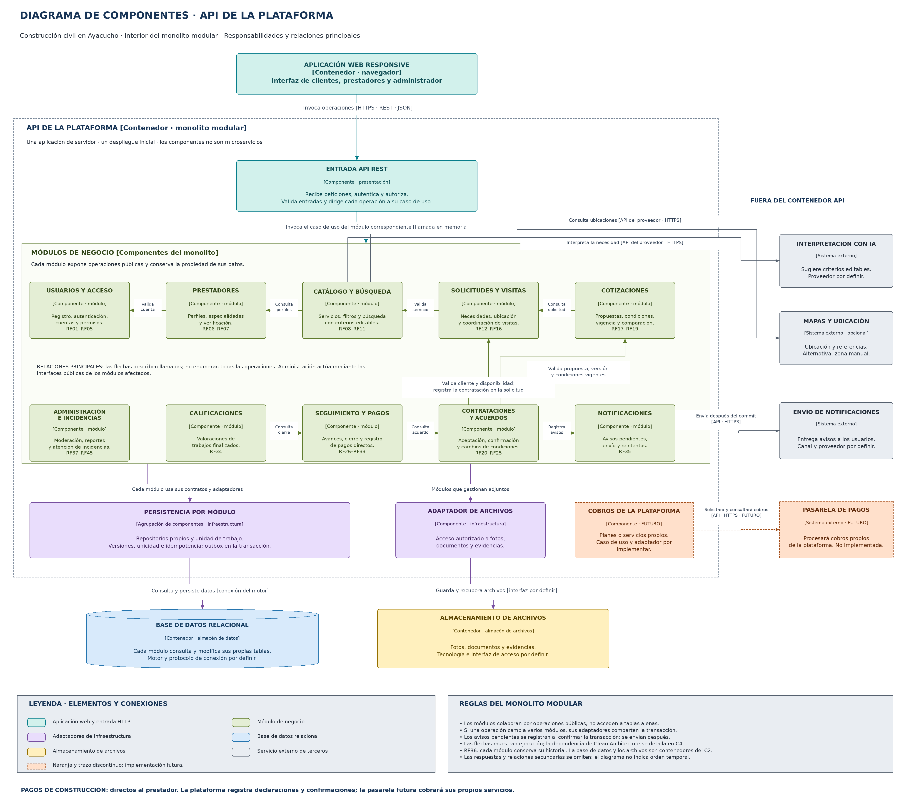

# Nivel 3 · Diagrama de componentes

> **Proyecto:** Plataforma web para la búsqueda y contratación de servicios de construcción civil en Ayacucho.  
> **Contenedor detallado:** API de la plataforma.  
> **Modelo:** C4 · Nivel 3 · Monolito modular.

## 1. Objetivo

Mostrar los componentes internos de la API: los diez módulos de negocio, la entrada HTTP, los adaptadores de persistencia y sus relaciones principales.

| Aspecto | Descripción |
|---|---|
| Pregunta que responde | ¿Cómo se divide el backend por dentro y qué hace cada parte? |
| Audiencia | Equipo de arquitectura y desarrollo. |
| Componente | Grupo de funcionalidades con responsabilidad definida e interfaces de acceso. En esta vista, cada módulo de negocio constituye un componente. |
| Alcance del detalle | API del nivel 2. La aplicación web y los almacenes quedan fuera de este contenedor, pero pertenecen a la plataforma. |
| Siguiente nivel | Clases e interacciones de Contrataciones y acuerdos. |

## 2. Diagrama

[Editar en Draw.io](../../img/fuentes-svg/nivel3-componentes.drawio) · [Versión SVG](../../img/fuentes-svg/nivel3-componentes.svg)

Las flechas muestran relaciones principales de ejecución. No son una secuencia ni enumeran todas las llamadas. Los colores y rótulos distinguen módulos, entrada HTTP, infraestructura, almacenes y proveedores.

## 3. Componentes

| Componente | Responsabilidad | Funcionalidades y requisitos | Ubicación lógica propuesta |
|---|---|---|---|
| Entrada API REST | Recibir y dirigir peticiones. | Autenticación, autorización, validación y traducción de errores. | Presentación y rutas del backend. |
| Usuarios y acceso | Mantener cuentas y permisos. | Registro, sesiones, recuperación y perfil; RF01–RF05. | `src/modules/usuarios/` |
| Prestadores | Mantener información de quienes ofrecen servicios. | Especialidades, experiencia, disponibilidad declarada y verificación; RF06–RF07. | `src/modules/prestadores/` |
| Catálogo y búsqueda | Organizar servicios y localizar prestadores registrados. | Categorías, filtros e interpretación asistida; RF08–RF11. | `src/modules/catalogo/` |
| Solicitudes y visitas | Gestionar necesidades y su evaluación. | Publicación, destinatarios, ubicación y visitas; RF12–RF16. | `src/modules/solicitudes/` |
| Cotizaciones | Mantener propuestas y condiciones. | Elaboración, versiones, vigencia y comparación; RF17–RF19. | `src/modules/cotizaciones/` |
| Contrataciones y acuerdos | Formalizar y conservar lo acordado. | Aceptación, confirmación, documentos, cambios y cancelaciones; RF20–RF25. | `src/modules/contrataciones/` |
| Seguimiento y pagos registrados | Registrar la ejecución y el cierre. | Avances, observaciones, conformidad y pagos directos declarados y confirmados; RF26–RF33. | `src/modules/seguimiento/` |
| Calificaciones | Gestionar valoraciones de trabajos finalizados. | Calificación vinculada a la contratación; RF34. | `src/modules/calificaciones/` |
| Notificaciones | Gestionar avisos internos y entregas externas. | Avisos pendientes, envío y reintentos; RF35. | `src/modules/notificaciones/` |
| Administración e incidencias | Atender moderación, control y reportes. | Gestión de usuarios, categorías, publicaciones, incidencias y auditoría; RF37–RF45. | `src/modules/administracion/` |
| Persistencia por módulo | Implementar el acceso a los datos de cada propietario. | Repositorios, versiones, unicidad y unidad de trabajo. | Infraestructura de cada módulo y configuración transaccional. |
| Adaptador de archivos | Conectar con el almacén de evidencias y documentos. | Carga y recuperación con permisos. | Infraestructura de los módulos que utilizan archivos. |
| Cobros de la plataforma | Cobrar planes o servicios propios. | Ampliación futura; no forma parte de los diez módulos actuales. | Módulo y adaptador por implementar. |

Las rutas son una propuesta lógica, no archivos ejecutables existentes. RF36 corresponde al historial conservado por cada módulo. La agrupación de persistencia facilita la lectura: no propone un único repositorio de negocio que mezcle todos los módulos.

## 4. Relaciones entre componentes

| Origen | Destino | Descripción | Comunicación |
|---|---|---|---|
| Entrada API REST | Módulo correspondiente | Invocar el caso de uso de la petición autorizada. | Llamada en memoria. |
| Prestadores | Usuarios y acceso | Validar la cuenta asociada al perfil. | Operación pública del módulo. |
| Catálogo y búsqueda | Prestadores | Consultar perfiles y especialidades para los resultados. | Operación pública del módulo. |
| Solicitudes y visitas | Catálogo y búsqueda | Validar el servicio seleccionado. | Operación pública del módulo. |
| Cotizaciones | Solicitudes y visitas | Consultar la solicitud para preparar o validar la propuesta. | Operación pública del módulo. |
| Contrataciones y acuerdos | Cotizaciones | Obtener la propuesta vigente y su versión. | Puerto de aplicación y adaptador hacia la API pública. |
| Contrataciones y acuerdos | Solicitudes y visitas | Validar cliente y disponibilidad y registrar la contratación. | Puerto de aplicación y operación pública transaccional. |
| Seguimiento y pagos registrados | Contrataciones y acuerdos | Consultar el acuerdo y solicitar las transiciones que correspondan al agregado. | Operaciones públicas del módulo propietario. |
| Calificaciones | Seguimiento y pagos registrados | Comprobar el cierre y la participación en el trabajo. | Operación pública de consulta. |
| Contrataciones y acuerdos | Notificaciones | Registrar avisos pendientes de la operación. | Puerto de aplicación; registro dentro de la transacción. |

Si Seguimiento necesita comprobar un estado administrado por Contrataciones, lo consulta mediante la API pública; no accede a sus tablas. Otros módulos también pueden generar avisos: se muestra Contrataciones como caso representativo. Administración utiliza las operaciones públicas de los módulos afectados, aunque esas conexiones secundarias no se dibujen.

## 5. Relaciones con contenedores y sistemas externos

| Componente | Destino | Finalidad | Comunicación prevista | Diseño aplicado |
|---|---|---|---|---|
| Cada módulo, mediante sus repositorios | Base de datos relacional | Consultar y persistir sus propios registros. | Conexión del motor por definir. | Repository y unidad de trabajo. |
| Adaptador de archivos | Almacenamiento de archivos | Guardar y recuperar fotos, documentos y evidencias. | Interfaz por definir. | Adapter y control de acceso. |
| Catálogo y búsqueda | Interpretación con IA | Proponer criterios editables. | API del proveedor sobre HTTPS. | Adapter; filtros como alternativa. |
| Catálogo y búsqueda | Mapas y ubicación | Consultar referencias geográficas. | API del proveedor sobre HTTPS. | Adapter opcional; zona manual. |
| Notificaciones | Servicio de envío de notificaciones | Entregar avisos después del commit. | API del proveedor sobre HTTPS. | Outbox transaccional, reintentos y deduplicación. |
| Cobros de la plataforma, futuro | Pasarela de pagos, futura | Procesar cobros por planes o servicios propios. | API del proveedor sobre HTTPS, pendiente. | Adapter previsto. |

La pasarela no procesa los pagos actuales de construcción ni representa una comisión por trabajo. La base de datos y los archivos son contenedores de la plataforma del C2; los proveedores externos pertenecen a terceros.

## 6. Reglas del monolito modular

| Regla | Aplicación y motivo |
|---|---|
| Un backend inicial | Los módulos de negocio se ejecutan y despliegan juntos en la misma aplicación de servidor. |
| Comunicación por operaciones públicas | Un módulo no importa implementaciones privadas de otro. |
| Propiedad de los datos | Cada módulo consulta y modifica sus tablas; las operaciones sobre datos ajenos se solicitan al propietario. |
| Transacción coherente | Los adaptadores que participan en una actualización coordinada comparten el contexto transaccional. |
| Concurrencia controlada | La unicidad, versión esperada e idempotencia protegen la contratación activa y los reintentos. |
| Avisos después del commit | La transacción conserva el aviso pendiente; el envío externo ocurre después y admite reintentos. |
| Clean Architecture | Dominio independiente; puertos en Aplicación; adaptadores en Infraestructura; controladores en Presentación. |
| Ampliación gradual | El cobro por servicios de la plataforma permanece futuro, sin introducirlo en la aceptación actual. |

El [diseño interno](../03-diseño-de-software/diseño-interno/diseño-interno-de-modulos.md) explica las capas y el contrato transaccional con mayor detalle.

---

[Índice del proyecto](../../README.md) · [Nivel anterior](02-nivel2-contenedores.md) · [Siguiente nivel](04-nivel4-codigo.md)
